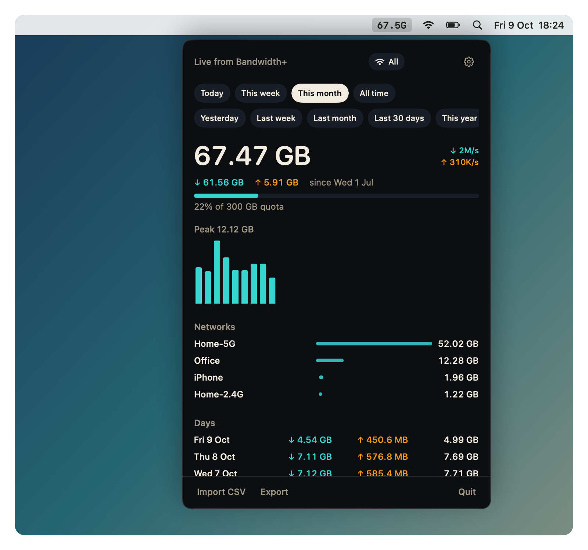
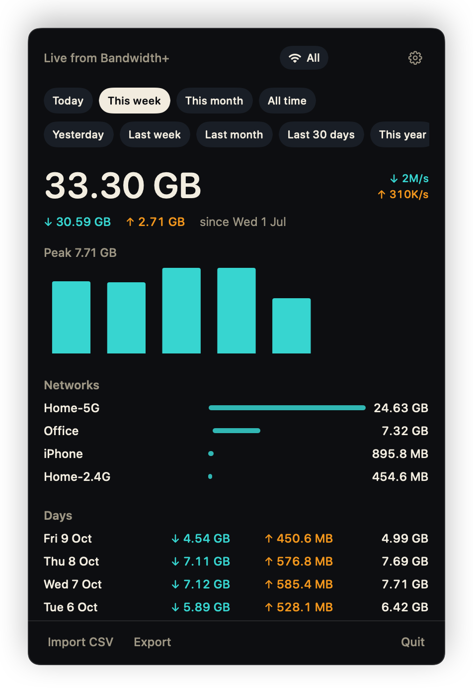
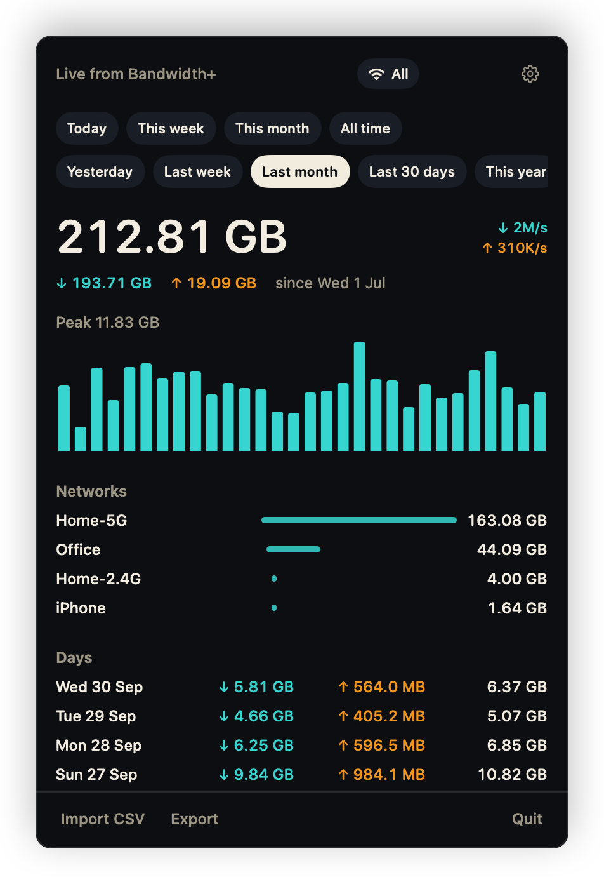
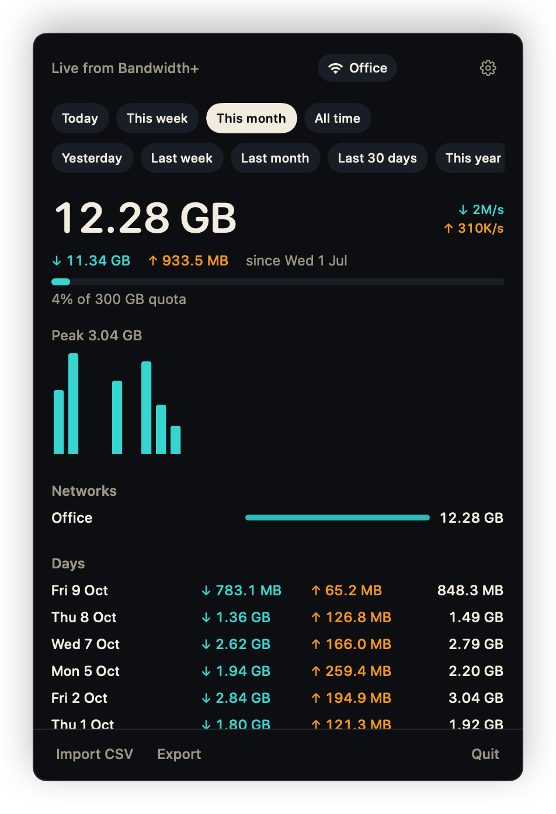
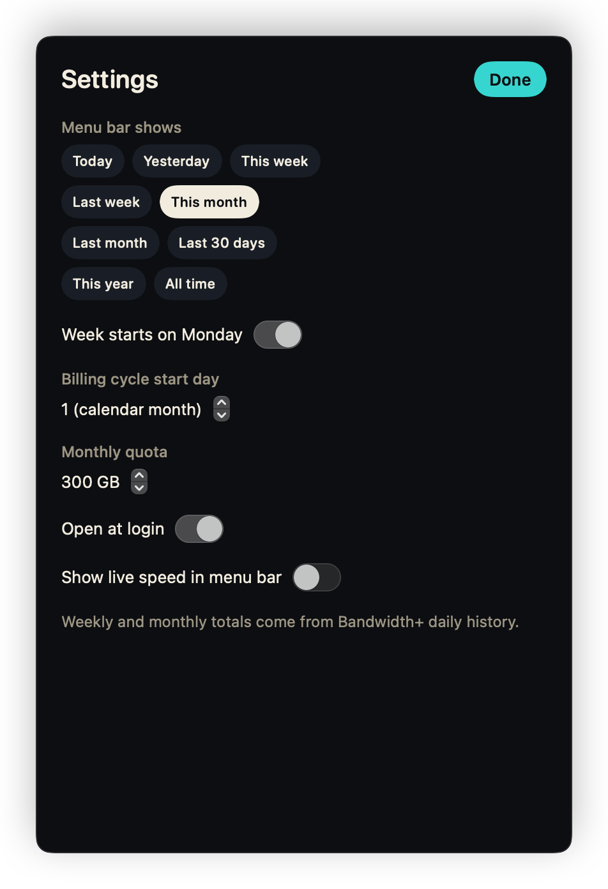
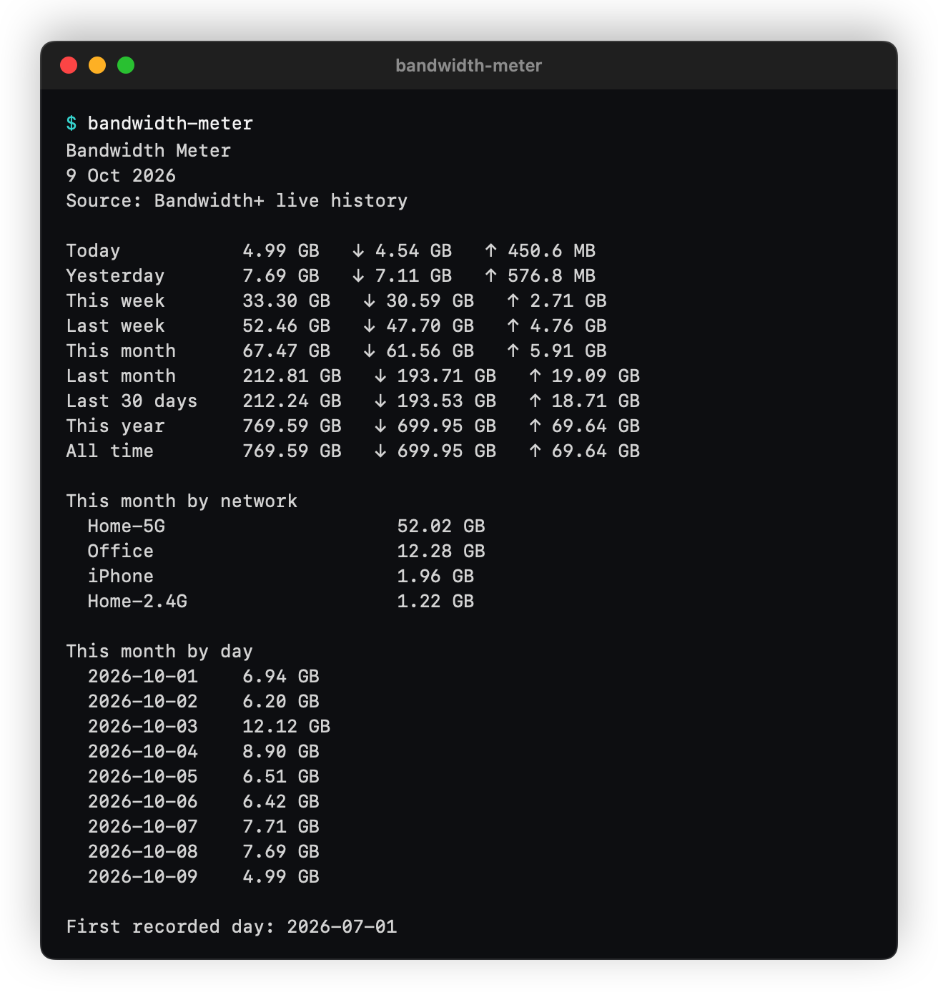
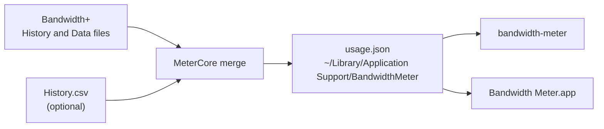

<h1 align="center">Bandwidth Meter</h1>

<p align="center">
  Weekly and monthly bandwidth totals for your Mac, from the daily history
  <a href="https://apps.apple.com/app/bandwidth/id490461369">Bandwidth+</a> already keeps.<br />
  A menu bar dashboard and a <code>bandwidth-meter</code> command, with no network access of their own.
</p>

<p align="center">
  <a href="https://github.com/ashahinL/macOS-Bandwidth-Meter/releases/latest"></a>
  <a href="https://github.com/ashahinL/macOS-Bandwidth-Meter/actions/workflows/ci.yml"></a>
  
  
  
  
  <a href="LICENSE"></a>
</p>

<p align="center">
  
</p>

<table align="center">
  <tr>
    <td align="center"><br /><sub>This week</sub></td>
    <td align="center"><br /><sub>Last month</sub></td>
    <td align="center"><br /><sub>One network</sub></td>
  </tr>
  <tr>
    <td align="center"><br /><sub>Settings</sub></td>
    <td align="center" colspan="2"><br /><sub>The <code>bandwidth-meter</code> summary</sub></td>
  </tr>
  <tr>
    <td align="center" colspan="3">
      <br />
      <br />
      <br />
      <sub>The menu bar label: this month's total in light and dark, or live speed</sub>
    </td>
  </tr>
</table>

<p align="center"><sub>The screenshots are the app's own SwiftUI views drawn with made-up demo data. <code>make shots</code> renders them again.</sub></p>

## What it does

Bandwidth+ records live speed and each day's usage per network, but it does
not total a week or a month. Bandwidth Meter reads the daily records Bandwidth+
already keeps and adds them up. Keep Bandwidth+ running so each day gets
recorded.

- **Totals for the periods you ask about.** Today, yesterday, this week, last
  week, this month, last month, last 30 days, this year, and all time.
- **Menu bar dashboard.** Period chips, the download and upload split, a daily
  chart, a quota bar, totals per network, and one row per day. The label in the
  menu bar is a compact total such as `67.5G`, or live speed if you prefer.
- **`bandwidth-meter` command.** Prints a summary and exits, so it never has to
  stay open. `--json` gives the same numbers to scripts.
- **Reads Bandwidth+ directly.** The app opens Bandwidth+'s sandboxed `History`
  file and today's `Data` file, so you don't have to export a CSV first.
- **CSV import and export.** Merge a Bandwidth+ `History.csv` export, and save
  the selected period as CSV from the panel.
- **One network at a time.** Filter the totals to one Wi-Fi or interface name
  from the panel or with `--network`.
- **Weeks and billing months.** Weeks start on Monday by default. A month can
  start on your billing day instead of the 1st, and an optional monthly quota
  shows how much of it you have used.
- **Decimal units.** 1 MB is 1,000,000 bytes, the same as Bandwidth+'s CSV.

Bandwidth Meter does not replace Bandwidth+. That app keeps capturing; this
one adds up. Without Bandwidth+, the menu bar app counts this Mac's own
interface bytes into today's totals instead. This project is not affiliated
with Bandwidth+.

## Install

You need macOS 14 or later on Apple Silicon, and
[Bandwidth+](https://apps.apple.com/app/bandwidth/id490461369) from the Mac App
Store, left running.

### Download

Get **`Bandwidth-Meter-<version>.dmg`** from
[Releases](https://github.com/ashahinL/macOS-Bandwidth-Meter/releases). You
don't need Xcode or Terminal.

1. Open the disk image and double-click **Install**.
2. Click through the installer and enter your password when it asks.

The installer puts **Bandwidth Meter.app** in `/Applications` and the
`bandwidth-meter` command in `/usr/local/bin`, which is already on your `PATH`.
It opens the app when it finishes, and ejects the disk image once you close the
installer window. To update, run the installer from a newer disk image. It
replaces the app and keeps your history and settings.

If Bandwidth+ isn't installed, the installer warns you before it starts. You
can continue anyway: **Import CSV** works without it, but the totals only stay
current when [Bandwidth+](https://apps.apple.com/app/bandwidth/id490461369)
records each day.

The installer isn't notarized yet, so macOS blocks it the first time you open
it:

- **macOS 15 or later:** click **Done** on the warning. Open **System Settings ›
  Privacy & Security**, scroll down to **Security**, and click **Open Anyway**
  next to "Install.pkg". Confirm with your password and the
  installer opens. Right-click › Open no longer gets past this check on
  macOS 15.
- **macOS 14:** right-click **Install**, choose **Open**, and
  click **Open** again.

You only do this once per download. The app and the command it installs open
normally afterwards.

If you installed an earlier version from a zip, the old command is still in `~/.local/bin`
and may come first on your `PATH`. Delete it with
`rm ~/.local/bin/bandwidth-meter`, or run the uninstaller from the disk image,
which removes it too.

### Build from source

```sh
xcode-select --install    # once, if you don't have Command Line Tools

git clone https://github.com/ashahinL/macOS-Bandwidth-Meter.git
cd macOS-Bandwidth-Meter

make                      # build the menu bar app and the CLI into dist/
make install              # CLI to ~/.local/bin, app to /Applications
```

`./build.sh` runs `make test app install` and then prints the summary.

### Uninstall

Open the disk image and double-click **Uninstall**. It lists
what it found, asks for your password, and removes the app, the
`bandwidth-meter` command, and the installer's receipt. It then asks whether
to delete your saved totals and settings as well. The default is to keep them.
It doesn't touch Bandwidth+. macOS may block the uninstaller the first time,
just like the installer; use **Open Anyway** the same way.

Without the disk image:

```sh
sudo rm -rf "/Applications/Bandwidth Meter.app" /usr/local/bin/bandwidth-meter
sudo pkgutil --forget dev.ashahin.BandwidthMeter.pkg
```

`make uninstall` removes a source install (`~/.local/bin` and `/Applications`).
To delete the saved totals and settings too:

```sh
rm -rf ~/Library/Application\ Support/BandwidthMeter
defaults delete dev.ashahin.BandwidthMeter
```

If you turned on **Open at login**, turn it off in the app's settings before
you uninstall, or remove it under **System Settings › General › Login Items**.

## Usage

### Command line

```sh
bandwidth-meter                 # full summary
bandwidth-meter today
bandwidth-meter week
bandwidth-meter last-week
bandwidth-meter month
bandwidth-meter last-month
bandwidth-meter 30d
bandwidth-meter year
bandwidth-meter all
bandwidth-meter json            # the full summary as JSON
```

| Option | What it does |
|---|---|
| `--import FILE.csv` | Merge a Bandwidth+ `History.csv` export |
| `--network NAME` | Limit totals to one Wi-Fi or interface name |
| `--json` | Machine-readable output |
| `--help` | Usage text |

```sh
bandwidth-meter month --network "Home"
bandwidth-meter --import ~/Desktop/History.csv
bandwidth-meter week --json
```

<details>
<summary>Sample output</summary>

```
$ bandwidth-meter
Bandwidth Meter
9 Oct 2026
Source: Bandwidth+ live history

Today           4.99 GB   ↓ 4.54 GB   ↑ 450.6 MB
Yesterday       7.69 GB   ↓ 7.11 GB   ↑ 576.8 MB
This week       33.30 GB   ↓ 30.59 GB   ↑ 2.71 GB
Last week       52.46 GB   ↓ 47.70 GB   ↑ 4.76 GB
This month      67.47 GB   ↓ 61.56 GB   ↑ 5.91 GB
Last month      212.81 GB   ↓ 193.71 GB   ↑ 19.09 GB
Last 30 days    212.24 GB   ↓ 193.53 GB   ↑ 18.71 GB
This year       769.59 GB   ↓ 699.95 GB   ↑ 69.64 GB
All time        769.59 GB   ↓ 699.95 GB   ↑ 69.64 GB

This month by network
  Home-5G                     52.02 GB
  Office                      12.28 GB
  iPhone                      1.96 GB
  Home-2.4G                   1.22 GB

This month by day
  2026-10-01    6.94 GB
  ...
  2026-10-09    4.99 GB

First recorded day: 2026-07-01
```

This is the demo data from the screenshots, not real usage.

</details>

### Menu bar app

Click the total in the menu bar to open the panel. Pick a period, click the
network button to cycle through your networks, and open settings from the gear.
**Import CSV** and **Export** sit at the bottom of the panel.

Settings stay inside the panel, because a system menu, picker, or sheet would
close a menu bar extra. In settings you choose:

- which period the menu bar label shows
- whether weeks start on Monday
- the billing cycle start day, from 1 to 28
- a monthly quota, which adds a usage bar under This month
- whether the app opens at login
- whether the label shows live speed instead of a total

Live speed comes from the Mac's 64-bit interface counters, sampled once a
second. Weekly and monthly totals still come from Bandwidth+ history. The app
has no Dock icon (`LSUIElement`).

## How it works



Bandwidth+ keeps one entry per day per network in NSKeyedArchiver files inside
its sandbox. Bandwidth Meter decodes them, merges them into its own store, and
sums the days that fall in the period you asked for.

<details>
<summary>Merging, weeks, and billing months</summary>

- **Precise numbers win.** Live Bandwidth+ byte counters outrank a CSV export,
  which rounds to 0.1 MB, for the same day and network. Importing the CSV again
  cannot replace exact totals with rounded ones.
- **A finished day does not shrink.** When two Bandwidth+ reads disagree about
  a day, the larger download and the larger upload are kept.
- **Fallbacks.** When Bandwidth+ gives no records, both the app and the CLI
  look for `~/Desktop/History.csv`. If there are no Bandwidth+ files at all,
  the menu bar app records this Mac's interface bytes under names like
  `Network (en0)` and says "Tracking this Mac".
- **Weeks** are ISO-style and start on Monday unless you turn that off.
- **Months** are calendar months, or billing cycles when you set a start day
  other than 1.
- **The app refreshes** from Bandwidth+ every two seconds while it runs. The
  CLI reads, merges, saves, prints, and exits.

</details>

## Privacy

Bandwidth Meter has no network code. It sends nothing anywhere and has no
analytics. It reads Bandwidth+'s two files, an optional CSV, and the Mac's
interface byte counters, and it writes one JSON file in your Library.
[PRIVACY.md](PRIVACY.md) lists every file it reads and writes.

## Troubleshooting

<details>
<summary><code>bandwidth-meter: no usage yet</code></summary>

Bandwidth+ has not written a day yet, or it is not installed. Leave it running,
use the network, and try again. You can also import a CSV:
`bandwidth-meter --import ~/Desktop/History.csv`.

</details>

<details>
<summary>Today keeps changing</summary>

Bandwidth+ records whole days. Today comes from its live `Data` file and keeps
growing until midnight.

</details>

<details>
<summary>The panel says it couldn't read Bandwidth+</summary>

The history file is there, but it is not an archive this app understands. The
numbers on screen are the last saved copy.

</details>

<details>
<summary>The panel or the CLI says it couldn't read <code>usage.json</code></summary>

The store file is damaged. Bandwidth Meter copied it to `usage.json.bak` next
to the original (or a timestamped `.bak` if one already exists) and rebuilt the
totals from Bandwidth+. Settings such as the billing day and quota went back to
their defaults. If the copy fails, it leaves the file alone and does not save
over it.

</details>

<details>
<summary>This week is only today</summary>

Weeks start on Monday. On a Monday, this week is just today, and last week is
the previous Monday to Sunday.

</details>

<details>
<summary>CSV and live totals disagree slightly</summary>

The CSV rounds to 0.1 MB. The live files keep exact bytes, and those win when
the two are merged.

</details>

<details>
<summary>The menu bar shows only a letter, or settings close the panel</summary>

Use a build from this repo. The label must be a single `Text`, and settings
cannot use `NSMenu`, `Picker`, or sheets.

</details>

<details>
<summary>The menu bar item is missing</summary>

The app runs as a background agent with no Dock icon. Check that it is running
with `pgrep -fl BandwidthMeter`, then check whether the menu bar is full.

</details>

<details>
<summary>macOS says it can't verify the installer</summary>

The installer isn't notarized yet. On macOS 15 or later, open **System
Settings › Privacy & Security**, scroll down to **Security**, and click **Open
Anyway**. Right-click › Open no longer works there. On macOS 14, right-click the
installer and choose **Open**. See [Download](#download).

If you built the app yourself and copied it from another Mac, clear the
download flag instead:

```sh
xattr -cr "/Applications/Bandwidth Meter.app"
```

</details>

## Development

```sh
make test       # run the self-test suite
make            # build the app and the CLI into dist/
make dmg        # build dist/Bandwidth-Meter-<version>.dmg (installer + uninstaller)
make shots      # render docs/screenshots from the real views
make help       # list every target
```

The tests are a Swift executable, `MeterSelfTest`, rather than XCTest, so they
run with Command Line Tools alone. They cover:

- this week, last week, and this month against known daily rows
- the network filter, in a single period and in the default summary
- a billing cycle that starts on the 15th
- parsing a Bandwidth+ CSV export, and reporting one that can't be parsed
- merge ranks: live Bandwidth+ bytes beat rounded CSV, and a later read does
  not shrink a day
- a damaged `usage.json` being copied aside before a save
- CLI period tokens and the compact menu bar format
- decoding Bandwidth+ archives, with a check against the real files that runs
  only when Bandwidth+ is installed

`make shots` runs the `MeterShots` target. It draws `DashboardView`,
`SettingsView`, and `MenuBarLabel` from `MeterUI` with a fixed demo dataset
(9 October 2026, networks named Home-5G, Office, Home-2.4G, and iPhone), and
draws the CLI summary from the same `Report.render` call the CLI uses. It
reads nothing from Bandwidth+ or your store. Run it before a release when the
UI changes.

<details>
<summary>Layout</summary>

```
Sources/MeterCore/              aggregation, Bandwidth+ reader, CSV, store, report
Sources/MeterUI/                SwiftUI panel, settings, menu bar label, sampler
Sources/BandwidthMeter/         the menu bar app entry point
Sources/BandwidthMeterCLI/      the bandwidth-meter command
Sources/InterfaceCounters/      64-bit interface counters (C)
Sources/MeterSelfTest/          self-test executable
Sources/MeterShots/             renders docs/screenshots
Resources/Info.plist            app bundle metadata
scripts/build-dmg.sh            builds the installer pkg, the uninstaller, and the disk image
packaging/pkg-scripts/          preinstall and postinstall for the pkg
packaging/installer/            installer welcome, conclusion, and distribution
packaging/uninstaller/          the Uninstall applet
packaging/dmg/                  disk image layout and background
docs/release-notes/             GitHub release notes, one file per version
Makefile                        build, test, shots, dmg, install
build.sh                        make test app install, then print a summary
.github/workflows/ci.yml        test, build, and check the disk image on macOS
.github/workflows/release.yml   publish the release when a v* tag is pushed
```

The app and the CLI both call `MeterCore`, so anything the panel shows is also
available from the terminal.

</details>

See [CONTRIBUTING.md](CONTRIBUTING.md) before opening a pull request,
[RELEASING.md](RELEASING.md) for how a version ships, and
[SECURITY.md](SECURITY.md) to report a problem privately. Changes are listed
in [CHANGELOG.md](CHANGELOG.md).

## Licence

MIT. See [LICENSE](LICENSE).
